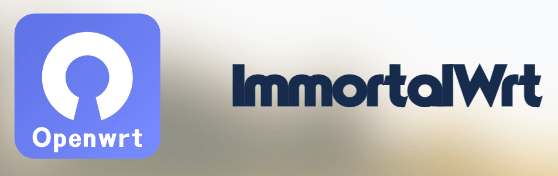

<div align="center">



# ImmortalWrt · 360 T7

**360 T7 · 双版本固件 · GitHub Actions 云编译**

Nikki 与 OpenClash，按你的使用习惯选择。

[](https://github.com/IraXu/ImmortalWrt-360T7/actions/workflows/pure-padavanonly-360t7-24.10-6.6.yml)
[](https://github.com/IraXu/ImmortalWrt-360T7/actions/workflows/pure-hanwckf.yml)
[](https://github.com/IraXu/ImmortalWrt-360T7/releases)

<p>
  <a href="https://github.com/IraXu/ImmortalWrt-360T7/releases"></a>
  <a href="https://github.com/IraXu/ImmortalWrt-360T7/actions"></a>
  <a href="https://github.com/IraXu/ImmortalWrt-360T7/issues"></a>
</p>

</div>

## 选择版本

两条路线分别维护配置与依赖，下载前先确认所需插件和设备布局。

<div align="center">
<table align="center">
  <thead>
    <tr>
      <th align="center">对比项</th>
      <th align="center">padavanonly · Nikki</th>
      <th align="center">hanwckf · OpenClash</th>
    </tr>
  </thead>
  <tbody>
    <tr>
      <td align="center">上游分支</td>
      <td align="center"><code>openwrt-24.10-6.6</code></td>
      <td align="center"><code>openwrt-21.02</code></td>
    </tr>
    <tr>
      <td align="center">内核系列</td>
      <td align="center">Linux 6.6</td>
      <td align="center">Linux 5.4</td>
    </tr>
    <tr>
      <td align="center">代理插件</td>
      <td align="center">Nikki + Mihomo</td>
      <td align="center">OpenClash</td>
    </tr>
    <tr>
      <td align="center">防火墙</td>
      <td align="center">firewall4 / nftables</td>
      <td align="center">firewall / iptables</td>
    </tr>
    <tr>
      <td align="center">目标设备</td>
      <td align="center"><code>360t7</code></td>
      <td align="center"><code>mt7981-360-t7-108M</code></td>
    </tr>
    <tr>
      <td align="center">编译配置</td>
      <td align="center"><a href="6.6_pure.config">6.6_pure.config</a></td>
      <td align="center"><a href="pure.config">pure.config</a></td>
    </tr>
  </tbody>
</table>
</div>

> [!IMPORTANT]
> 下载或刷写前，请核对设备分区、固件文件名及对应 Release 说明；不要仅凭“360 T7”混刷不同布局的镜像。

仓库还保留其他构建工作流，具体源码与配置以各工作流为准；上表列出的是这两条构建路线。

## 默认登录


<div align="center">
<table align="center">
  <thead>
    <tr>
      <th align="center">项目</th>
      <th align="center">默认值</th>
    </tr>
  </thead>
  <tbody>
    <tr>
      <td align="center">管理地址</td>
      <td align="center"><strong>http://192.168.77.1</strong></td>
    </tr>
    <tr>
      <td align="center">用户名</td>
      <td align="center"><code>root</code></td>
    </tr>
    <tr>
      <td align="center">初始密码</td>
      <td align="center">空</td>
    </tr>
  </tbody>
</table>
</div>

首次登录后请设置管理密码。保留旧配置升级时，管理地址、密码和其他设置可能沿用原配置，以设备实际状态及对应 Release 说明为准。

## 下载与使用

1. 打开 [Releases](https://github.com/IraXu/ImmortalWrt-360T7/releases)，根据 **Nikki / OpenClash**、上游版本选择对应发布。
2. 在附件中选择适用的镜像。`sysupgrade` 用于已安装兼容 OpenWrt/ImmortalWrt 系统的升级流程；`factory` 的用途取决于设备现有系统和引导环境，不能直接当作通用升级包。
3. 如发布附带 `sha256sums` 或 `SHA256SUMS`，核对镜像校验值。升级前备份配置，跨大版本切换时先确认配置兼容性。

编译记录见 [Actions](https://github.com/IraXu/ImmortalWrt-360T7/actions)。某次构建使用的源码提交、软件包版本和默认设置，以该次运行及发布附件为准。

## 自行编译

1. Fork 本仓库，并在自己的仓库中启用 Actions。
2. 修改对应的 `*.config` 文件；需要添加 feeds 或自定义默认设置时，再调整 DIY 脚本及工作流。
3. 在 Actions 页面选择对应工作流，点击 **Run workflow**。
4. 成功后，从运行页面的 **Artifacts** 或对应 Release 下载产物。

带 `clean` 输入的工作流，其具体行为以工作流说明为准；启用缓存后，日常构建通常无需清理，首次构建仍需建立缓存。

<details>
<summary><strong>项目结构与文件职责</strong></summary>

```text
ImmortalWrt-360T7/
├── .github/workflows/
│   ├── pure-padavanonly-360t7-24.10-6.6.yml  # 24.10 / 6.6 / Nikki
│   ├── pure-hanwckf.yml                    # 21.02 / 5.4 / OpenClash
│   └── …                                  # 其他构建工作流
├── 6.6_pure.config                         # Nikki 版本编译配置
├── pure.config                             # hanwckf / OpenClash 编译配置
├── diy-part1.sh                            # 更新 feeds 前执行
├── diy-part2.sh                            # 更新 feeds 后的自定义步骤
├── logo.png
├── LICENSE
└── README.md
```

工作流决定实际执行顺序。最终软件包选择由配置文件、目标默认包和依赖解析共同决定；若发布提供配置报告或 manifest，可用它们核对固件实际内容。

</details>

## 问题反馈

提交 [Issue](https://github.com/IraXu/ImmortalWrt-360T7/issues) 时，请附上所用固件文件名、设备分区布局、是否保留旧配置、复现步骤，以及相关 Actions / Release 链接，便于定位问题。

## 致谢

感谢以下项目及其贡献者：

- [ImmortalWrt](https://github.com/immortalwrt/immortalwrt)
- [hanwckf / immortalwrt-mt798x](https://github.com/hanwckf/immortalwrt-mt798x)
- [padavanonly / immortalwrt-mt798x-6.6](https://github.com/padavanonly/immortalwrt-mt798x-6.6) · [immortalwrtARM](https://github.com/padavanonly/immortalwrtARM)
- [Nikki](https://github.com/nikkinikki-org/OpenWrt-nikki) · [Mihomo](https://github.com/MetaCubeX/mihomo) · [OpenClash](https://github.com/vernesong/OpenClash)
- [P3TERX / Actions-OpenWrt](https://github.com/P3TERX/Actions-OpenWrt)

本仓库许可证见 [LICENSE](LICENSE)；上游源码及内置软件遵循各自许可证。
